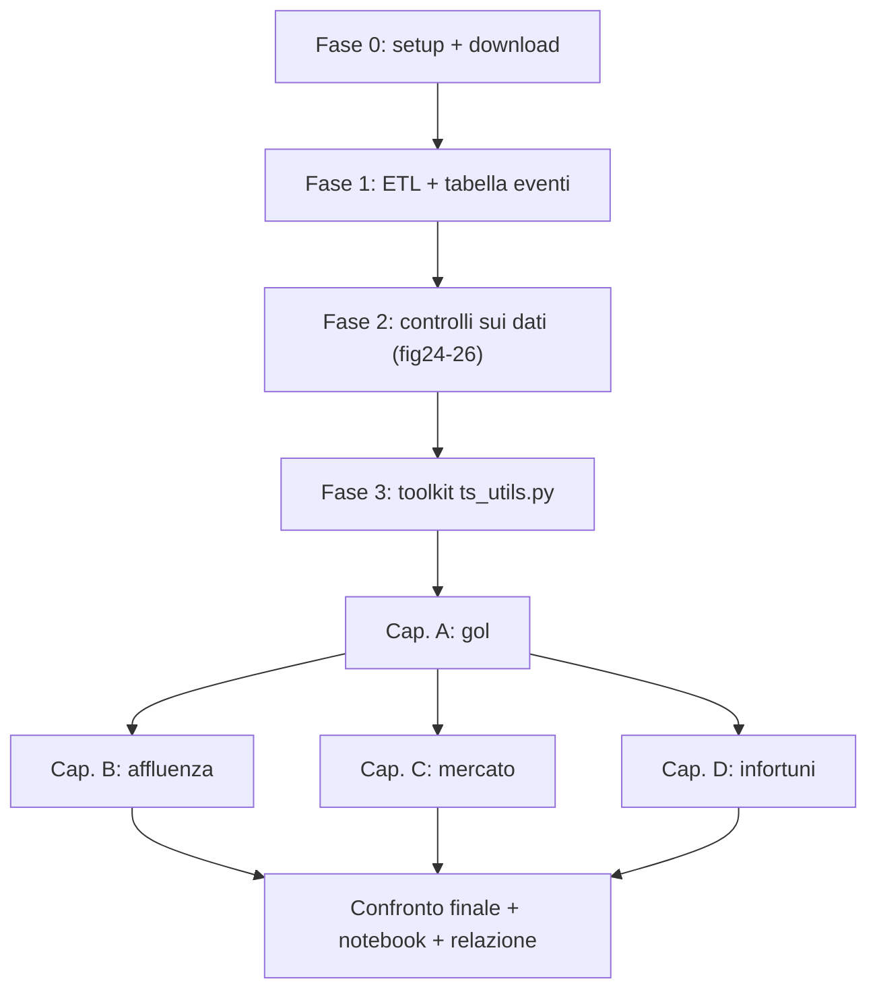

# Piano operativo – Parte II: Time Series sul calcio (Transfermarkt)

Va letto insieme a [struttura_time_series.md](file:///c:/Users/andre/Documents/GitHub/Progetto-Data-Science/struttura_time_series.md): quello dice **cosa** dimostriamo, questo dice **come**, passo per passo.

**Legenda:** ★ = figura obbligatoria · ☆ = figura opzionale (se lo spazio basta) · `tabXX` = tabella nella relazione.
Le figure continuano la numerazione della Parte I (Spotify finisce a `fig23`).

---

## FASE 0 – Setup

1. **Cartelle** (stessa logica della Parte I):
   ```
   data/football/raw/        ← CSV originali di Kaggle
   data/football/processed/  ← tabelle pulite e serie mensili (.parquet)
   data/football/eventi.csv  ← tabella eventi fatta a mano
   figures/                  ← fig24_… in poi
   scripts/ts_utils.py       ← funzioni riusabili (toolkit, vedi Fase 3)
   scripts/ts_01_etl.py … ts_06_confronto.py
   Football_TimeSeries.ipynb ← notebook finale
   ```
2. **Librerie**: `pip install pandas numpy pyarrow matplotlib seaborn statsmodels pmdarima prophet ruptures xgboost scikit-learn kagglehub`
3. **Download** di `davidcariboo/player-scores` (con `kagglehub` o a mano) in `data/football/raw/`.
4. **Stile grafico unico**: un `plt.style` e una palette fissi, 300 DPI, stessa grandezza dei font della Parte I. Colori fissi per gli eventi in tutte le figure: VAR = blu, 5 cambi = verde, COVID = grigio, recuperi = arancio, Neymar = rosso.

---

## FASE 1 – ETL (`ts_01_etl.py`)

### 1.1 Filtri comuni
- **Competizioni**: Serie A, Premier League, LaLiga, Bundesliga, Ligue 1, Champions League, Coppa Italia. I codici vanno letti in `competitions.csv`: dovrebbero essere `IT1`, `GB1`, `ES1`, `L1`, `FR1`, `CL`, `CIT`, ma **verificali**.
- **Periodo**: dalla stagione 2012/13 all'ultima completa. L'eventuale stagione in corso la escludiamo dal training, oppure la usiamo solo come test.
- Colonne `date` convertite in `datetime`; `season` è l'anno d'inizio della stagione.

### 1.2 Tabella partite (`games`)
- `total_goals = home_club_goals + away_club_goals`
- `round_num` = numero estratto da `round` ("12. Matchday" → 12)
- `is_big_match` = entrambe le squadre tra le prime 6 **della stagione precedente** (le posizioni pre-partita a inizio stagione sono vuote o poco sensate) **oppure** derby (lista manuale: Milano, Roma, Torino, Genova + derby d'Italia, ecc.)
- `is_midweek` = la partita si gioca tra martedì e giovedì
- `attendance`: distinguere **0 / NaN** e segnare `porte_chiuse` usando la tabella eventi

### 1.3 Eventi (`game_events`)
- **Gol**: `type == 'Goals'`. Vanno **esclusi gli eventi dei rigori a fine partita** se presenti (es. un `type` "Shootout"): non sono gol della partita.
- **Minuto**: scartare `minute < 0` o mancanti; `late_75 = minute >= 75`, `stoppage_90 = minute >= 90`.
- **Cambi**: `type == 'Substitutions'`
  - `is_injury_sub = description.str.contains('Injury', case=False)`
  - `reason_reported` = la descrizione contiene un motivo (Injury o altro) **contro** "non riportato" o vuota
- **Gol da subentrato**: un gol in cui `player_id` compare come `player_in_id` di un cambio **della stessa partita** avvenuto a un minuto ≤ di quello del gol.
- **Rigori in partita** *(bonus VAR)*: gol con "Penalty" in `description`, se presente.

### 1.4 Calendario per club (`club_games` + `games`)
- Ordinare le partite di ogni club per data, **tutte le competizioni insieme**.
- `rest_days` = giorni dalla partita precedente del club; la prima partita della stagione → NaN.
- `games_last_30d` = partite del club nei 30 giorni prima.
- `short_rest = rest_days < 4`
- Le nazionali **non ci sono**: va scritto tra i limiti.

### 1.5 Mercato
- **`transfers`**: tenere solo `transfer_fee > 0` per la spesa; `is_free` per la quota di parametri zero; `overpay = transfer_fee / market_value_in_eur` (solo dove entrambi > 0), tagliato tra il 1° e il 99° percentile.
- **`player_valuations`** → pannello **mensile per giocatore**: si porta avanti l'ultima valutazione (ffill) per al massimo 12 mesi, si tengono solo i giocatori di club Top-5 in quella data, poi si aggrega (mediana, 90° percentile, somma dei top-100).

### 1.6 Indice temporale "mese di stagione" (regola chiave)
- Per le serie di **campo** (gol, affluenza, infortuni) usiamo solo i mesi **agosto → maggio** = 10 "slot" a stagione, quindi **s = 10**.
- **2019/20**: le partite di giugno–luglio 2020 vanno negli slot vuoti di aprile–maggio 2020, perché sono le giornate rinviate. **Lo scriviamo nella relazione.**
- Uno slot con meno di N partite (es. dicembre 2022 in Serie A) diventa NaN: interpolazione lineare per STL/ADF; SARIMAX invece gestisce i NaN da solo.
- Per le serie di **mercato** usiamo il calendario normale, **s = 12** (si compra anche a giugno e luglio).

### 1.7 Tabella eventi (`eventi.csv`)
Colonne: `evento, lega, data_inizio, data_fine, tipo` (VAR, 5 cambi, porte chiuse, capienza 50/75%, Qatar, recuperi, Neymar, Saudi, nuova Champions, contestazioni Lazio). Da qui si generano **automaticamente** le dummy per ogni serie.

### 1.8 Output (in `processed/`)
| File | Una riga per | Usata in |
|---|---|---|
| `goals_monthly.parquet` | lega × slot | Cap. A |
| `attendance_monthly.parquet` | slot (Serie A) + per club (Lazio, Roma) | Cap. B |
| `market_monthly.parquet` | mese di calendario | Cap. C |
| `congestion_injuries_monthly.parquet` | lega × slot | Cap. D |
| `club_matches.parquet` | club × partita | figure trasversali (riposo, rotazione) |

---

## FASE 2 – Controlli sui dati (prima di qualsiasi modello)

| Fig. | Tipo | Cosa mostra / perché serve |
|---|---|---|
| **fig24_ts_copertura_dati** ★ | heatmap lega × stagione | % di partite con eventi minuto per minuto e % con affluenza → **da quale stagione possiamo partire** davvero |
| **fig25_ts_motivi_sostituzioni** ★ | barre impilate per stagione | quota di cambi "Injury" / altro motivo / non riportato. **Fondamentale**: se i motivi registrati aumentano nel tempo, un aumento degli infortuni potrebbe essere solo un effetto della registrazione |
| **fig26_ts_timeline_eventi** ★ | timeline orizzontale per lega | tutte le novità (VAR, 5 cambi, COVID, Qatar, nuova Champions) → figura d'apertura della Parte II |

**`tab01` – Riepilogo dataset:** righe, periodo, % mancanti per colonna chiave.

> [!IMPORTANT]
> **Regola di normalizzazione degli infortuni:** la serie principale è
> `cambi per infortunio / cambi con motivo registrato`,
> affiancata da `cambi per infortunio ogni 100 partite-club`. Se le due si muovono insieme, il risultato è robusto. Se divergono, il dato non è affidabile e lo dichiariamo.

---

## FASE 3 – Toolkit di funzioni (`ts_utils.py`)

Scritte **una volta sola** e richiamate in ogni capitolo. Così le figure di tutti i capitoli hanno lo stesso aspetto (come nei PDF).

| Funzione | Produce |
|---|---|
| `plot_series_with_events(s, eventi)` | serie + media mobile + linee verticali colorate per gli eventi |
| `plot_stl(s, period)` | 4 pannelli: osservata, trend, stagionalità, residuo |
| `stationarity_table(s)` | ADF (statistica, p-value, valori critici 1/5/10%) **+ KPSS**, prima e dopo la differenziazione |
| `plot_acf_pacf(s)` | ACF e PACF affiancati |
| `fit_auto_arima(s, m)` | ordine scelto + AIC (per `tab`) |
| `fit_sarimax(y, exog, order, seasonal_order)` | modello + `summary` |
| `plot_diagnostics(model)` | i 4 pannelli dei PDF: residui standardizzati, istogramma + KDE vs N(0,1), Q-Q, correlogramma |
| `ljungbox_table(model)` | lag 10, 20, 30: `lb_stat`, `lb_pvalue` |
| `plot_forecast(train, test, pred, ci)` | train, test, previsione e banda di confidenza al 95% |
| `baselines(train, test, s)` | naive, seasonal naive, media |
| `metrics_table(y, yhat, y_train, s)` | MAE, MSE, RMSE, MAPE, **MASE**, R² |
| `walk_forward(model_fn, y, exog, n_splits)` | metriche medie su finestre che si allargano |
| `counterfactual(y, exog, data_evento)` | si addestra prima dell'evento, si prevede dopo → grafico con l'area tra reale e controfattuale + effetto medio con intervallo di confidenza |
| `chow_test(y, data)` · `cusum(y)` · `plot_ruptures(y)` | test di rottura strutturale |
| `granger_table(df, target, cause, maxlag)` | p-value per ogni lag |
| `fit_prophet(df, holidays, regressors)` | previsione + grafico delle componenti |

### Regole fisse per tutti i capitoli
1. **Una serie principale per capitolo** riceve il trattamento completo di Box-Jenkins (STL → ADF/KPSS → ACF/PACF → ARIMA → SARIMA → SARIMAX → diagnostica). Le serie secondarie ricevono solo modello finale + metriche, per non fare 200 figure.
2. **Test set** = ultime 2 stagioni (20 slot) per le serie s=10; ultimi 24 mesi per le serie s=12.
3. Ogni tabella di metriche contiene **sempre le baseline** in cima.
4. MAPE solo se il target è lontano da zero; altrimenti MASE.
5. Le dummy di intervento entrano come `exog` in SARIMAX e come `holidays`/regressori in Prophet.

---

## CAP. A – I gol: VAR, 5 cambi, recuperi, finali di partita (`ts_02_gol.py`)

**Serie principale:** A1 = gol medi a partita, Top-5 aggregato, mensile s=10.
**Serie secondarie:** A2 = quota gol ≥ 75' · A3 = quota gol ≥ 90' · A4 = quota gol da subentrati · A5 = rigori a partita (se disponibili).

### Passi
1. Costruire A1–A5 per lega e per il Top-5 aggregato.
2. EDA: figure 27–31.
3. Box-Jenkins completo su A1: figure 32–35, `tab02`–`tab04`.
4. SARIMA (s=10) e poi SARIMAX con le dummy `VAR`, `cinque_cambi`, `recuperi_lunghi`, `porte_chiuse` + esogena `cambi_medi_partita`.
5. Coefficienti delle dummy → `tab05` + figura 38: **è la risposta numerica alla tesi** ("dopo il VAR +x gol a partita, p = …").
6. **Controfattuale VAR** su Serie A (VAR 2017/18) e confronto con la Premier (VAR solo dal 2019/20) come gruppo di controllo.
7. **Esperimento naturale Premier 2020/21** (stadi vuoti, 3 cambi) contro le altre leghe (stadi vuoti, 5 cambi).
8. Chow sulle date note + `ruptures` (punto di rottura trovato dai dati) → coincidono?
9. Prophet con le date degli eventi come "holiday".
10. Metriche e baseline sul test → `tab06`.
11. A2–A4: SARIMAX finale + coefficienti delle dummy → `tab07`.

### Figure
| Fig. | Tipo | Cosa guardare / cosa scrivere |
|---|---|---|
| **fig27_gol_mensili_top5** ★ | linea + media mobile 10 slot + eventi | c'è un cambio di livello dopo il 2017 o dopo il 2020? |
| **fig28_gol_per_lega_var** ★ | 5 grafici piccoli, linea VAR della propria lega | il salto (se c'è) segue la **data della singola lega**? Se sì, l'effetto è del VAR e non del periodo |
| **fig29_minuto_gol_pre_post** ★ | istogramma a classi di 5', pre-2020 vs post-2020 sovrapposti | la coda dopo il 75' e al 90'+ si "ingrossa"? |
| **fig30_quota_gol_finali** ★ | due linee: % gol ≥ 75' e ≥ 90' + eventi | effetto di 5 cambi e recuperi lunghi |
| **fig31_subentrati_vs_cambi** ★ | doppio asse: % gol da subentrati e cambi medi a partita | i due andamenti si muovono insieme dal 2020? |
| **fig32_stl_gol** ★ | STL (s=10) | stagionalità dentro la stagione (si segna di più a inizio o a fine stagione?) |
| **fig33_acf_pacf_gol** ★ | ACF/PACF (della serie differenziata se serve) | scelta di p e q |
| **fig34_arima_gol** ★ | previsione sul test + IC 95% | probabile "appiattimento" sulla media (come nei PDF) → giustifica SARIMA/SARIMAX |
| **fig35_diag_arima_gol** ★ | 4 pannelli di diagnostica | residui ≈ rumore bianco? |
| fig36_sarima_gol ☆ | previsione sul test | miglioramento rispetto ad ARIMA |
| **fig37_sarimax_gol** ★ | previsione + diagnostica (2 righe) | il modello migliore |
| **fig38_effetti_regole** ★ | forest plot: coefficienti delle dummy ± IC 95% | **la figura chiave del capitolo** |
| **fig39_controfattuale_var** ★ | Serie A reale vs controfattuale "senza VAR", area tra le due | effetto cumulato del VAR |
| fig40_changepoint_gol ☆ | serie + punti di rottura di `ruptures` | i dati "trovano da soli" le date delle riforme? |
| **fig41_premier_2021** ★ | barre per lega × stagione (2018/19–2022/23), Premier 20/21 evidenziata | separa l'effetto 5 cambi da quello porte chiuse |
| fig42_prophet_gol ☆ | componenti di Prophet | trend + effetti eventi |

### Tabelle
`tab02` ADF/KPSS · `tab03` ordine `auto_arima` + AIC · `tab04` Ljung-Box (ARIMA vs SARIMAX) · `tab05` coefficienti SARIMAX · `tab06` metriche vs baseline · `tab07` effetti su A2–A4 · `tab08` Chow (F, p-value per ogni data).

---

## CAP. B – Affluenza negli stadi (`ts_03_affluenza.py`)

**Serie principale:** B1 = affluenza media per partita, Serie A, mensile s=10.
**Secondarie:** B2 = riempimento % · B3 = Lazio vs Roma · B4 = per competizione.

### Passi
1. Costruire B1 (solo partite di campionato) e le esogene: dummy fasi COVID (`chiuso`, `cap50`, `cap75`), `quota_big_match`, `quota_midweek`, `gol_medi_mese_precedente` (**ritardati**), `fase_stagione` (giornata media del mese).
2. EDA: figure 43–47.
3. Box-Jenkins completo su B1: figure 48–51.
4. **Granger** (gol → affluenza, big match → affluenza) → `tab10`.
5. **Controfattuale COVID**: training fino a febbraio 2020, previsione fino a oggi → gli stadi sono tornati sul trend? (escludere i mesi a porte chiuse dal calcolo dell'effetto "ritorno").
6. Prophet con holiday (lockdown, capienze ridotte, Mondiale) + regressori.
7. **Caso Lazio**: serie Lazio e Roma in casa all'Olimpico, normalizzate (indice 2012/13 = 100); serie del divario Lazio−Roma; dummy per le contestazioni (date da fonti giornalistiche); SARIMAX sul divario.
8. Metriche e baseline → `tab11` (test **dopo il 2022**, così niente zeri da porte chiuse nel MAPE).

### Figure
| Fig. | Tipo | Cosa guardare / cosa scrivere |
|---|---|---|
| **fig43_affluenza_serie_a** ★ | linea + fasce grigie per le fasi COVID | trend di lungo periodo + crollo |
| **fig44_zoom_covid** ★ | zoom 2019–2023 con le fasce di capienza | come si riempie di nuovo lo stadio, fase per fase (stile Fig. 38 del PDF 2) |
| **fig45_profilo_giornata** ★ | media ± IC per giornata 1–38 | **inizio/fine campionato**: picco iniziale, calo a metà, volata finale |
| **fig46_box_competizione_bigmatch** ★ | due boxplot: per competizione, big match sì/no | quanto vale un big match in spettatori |
| **fig47_corr_lag** ★ | heatmap: affluenza vs esogene ai lag 0–3 | quali esogene usare (insieme a Granger) |
| **fig48_stl_affluenza** ★ | STL | — |
| **fig49_acf_pacf_affluenza** ★ | ACF/PACF | — |
| **fig50_modelli_affluenza** ★ | 3 pannelli: ARIMA, SARIMA, SARIMAX sul test | progressione dei modelli |
| **fig51_diag_sarimax_affluenza** ★ | 4 pannelli | — |
| **fig52_controfattuale_covid** ★ | reale vs "mondo senza COVID" | recupero totale, parziale o superamento del trend |
| **fig53_prophet_affluenza** ★ | componenti + effetto delle holiday | — |
| **fig54_lazio_vs_roma** ★ | 2 pannelli: indici Lazio/Roma, poi divario + marcatori delle contestazioni | effetto tifoseria/presidenza a parità di stadio |

### Tabelle
`tab09` ADF/KPSS + `auto_arima` · `tab10` Granger · `tab11` metriche vs baseline · `tab12` coefficienti SARIMAX (big match, fasi COVID, gol ritardati, fase stagione).

> [!TIP]
> Nella relazione spiega perché i gol entrano **ritardati**: il biglietto si compra prima della partita, quindi i gol di quella partita non possono influire su quanti tifosi ci sono.

---

## CAP. C – Calciomercato ed effetto Neymar (`ts_04_mercato.py`)

**Serie principale:** C1 = spesa mensile in trasferimenti Top-5, calendario, s=12, **in log**.
**Secondarie:** C2 = indice del valore di mercato (mediana, 90° percentile) · C3 = sovrapprezzo (gemello del Close−Open di Nvidia).

### Passi
1. Costruire C1, C2, C3 + esogene: `n_trasferimenti` (il "Volume"), `quota_parametri_zero`, `eta_media_acquisti`, dummy `neymar_2017`, `covid_2020`, `saudi_2023`.
2. EDA: figure 55–58.
3. Box-Jenkins su log(C1): figure 59–62. Holt-Winters **moltiplicativo** come modello in più.
4. **Controfattuale Neymar**: training fino a luglio 2017, previsione dopo → di quanto la spesa reale supera quella prevista.
5. Chow + `ruptures` sulla serie mensile e su C2.
6. C3 con `n_trasferimenti` come esogena: replica del Cap. 7 del PDF 2, ma valutata con **MASE**.
7. Metriche → `tab14`. Attenzione: il modello lavora in log, quindi le previsioni vanno **riportate in euro** prima di calcolare le metriche.

### Figure
| Fig. | Tipo | Cosa guardare / cosa scrivere |
|---|---|---|
| **fig55_spesa_mensile** ★ | linea in scala log + eventi | livello prima e dopo il 2017; crollo 2020 |
| **fig56_stagionalita_mercato** ★ | boxplot per mese dell'anno | picchi a gennaio e luglio–agosto → giustifica s=12 |
| **fig57_violin_fee** ★ | violin dei prezzi (log) pre/post agosto 2017 | si sposta tutta la distribuzione, non solo i top |
| **fig58_indice_valori** ★ | mediana, 90° percentile, top-100 | i valori salgono per tutti o solo per i top? |
| **fig59_stl_mercato** ★ | STL della serie log | — |
| **fig60_acf_pacf_mercato** ★ | ACF/PACF | — |
| **fig61_modelli_mercato** ★ | Holt-Winters vs SARIMA vs SARIMAX sul test | — |
| **fig62_diag_mercato** ★ | 4 pannelli | — |
| **fig63_controfattuale_neymar** ★ | reale vs "senza Neymar", area tra le due | **la figura chiave del capitolo** |
| fig64_changepoint_mercato ☆ | punti di rottura di `ruptures` | la rottura cade vicino ad agosto 2017? |
| **fig65_sovrapprezzo_volume** ★ | doppio asse: sovrapprezzo medio e n. trasferimenti | gemello della Fig. 58 del PDF 2 |
| **fig66_sarimax_sovrapprezzo** ★ | previsione sul test + IC | — |

### Tabelle
`tab13` ADF/KPSS + `auto_arima` · `tab14` metriche vs baseline · `tab15` coefficienti SARIMAX (dummy Neymar/COVID/Saudi) · `tab16` Chow · `tab17` Ljung-Box.

---

## CAP. D – Intasamento del calendario e infortuni (`ts_05_infortuni.py`)

**Serie principale:** D1 = **cambi per infortunio / cambi con motivo registrato**, Top-5, mensile s=10.
**Secondarie:** D2 = cambi per infortunio ogni 100 partite-club · D3 = rotazione media della formazione titolare.
**Esogene di congestione:** `games_last_30d` medio, `rest_days` medio, `quota_short_rest`, `quota_partite_europee`, dummy `qatar_2022`, `nuova_champions_2024`.

### Passi
1. Costruire D1–D3 e le esogene mensili, partendo da `club_matches.parquet`.
2. Controllare la fig25 (registrazione dei motivi): se nelle prime stagioni è troppo bassa, **si parte dalla prima stagione affidabile**.
3. EDA: figure 67–71.
4. **Correlazione incrociata (CCF)** e **Granger** congestione → infortuni (lag 0–3) → figura 72, `tab19`.
5. Box-Jenkins su D1: figure 73–74.
6. **Modello VAR** (congestione, infortuni): ordine scelto con AIC (`tab20`) + **funzione di risposta all'impulso** (fig75): "uno shock di +1 partita in 30 giorni → quanti infortuni in più nei mesi dopo?".
7. **XGBoost** con feature ritardate (lag 1–3 del target, congestione ritardata, slot della stagione) → previsione + importanza delle feature (fig76).
8. Analisi **trasversale** a livello di partita (fig70): tasso di cambi per infortunio per fascia di riposo. È l'evidenza più intuitiva per la tesi.
9. Metriche → `tab21`.

### Figure
| Fig. | Tipo | Cosa guardare / cosa scrivere |
|---|---|---|
| **fig67_riposo_per_stagione** ★ | boxplot dei giorni di riposo per stagione | il riposo si accorcia nel tempo? |
| **fig68_congestione_mensile** ★ | partite in 30 giorni + quota sotto i 4 giorni + eventi | picchi in inverno, effetto Qatar e nuova Champions |
| **fig69_infortuni_mensili** ★ | D1 e D2 sovrapposte + eventi | andamento degli infortuni + verifica di robustezza (le due vanno insieme?) |
| **fig70_infortuni_per_riposo** ★ | barre (con IC) per riposo di 2, 3, 4, 5, 6, 7+ giorni | **la figura chiave**: meno riposo → più infortuni? |
| fig71_minuto_cambi_infortunio ☆ | istogramma pre/post 2020 | gli infortuni avvengono più nel finale (stanchezza)? |
| **fig72_ccf_congestione** ★ | correlazione incrociata per lag | effetto immediato o ritardato |
| **fig73_stl_infortuni** ★ | STL | stagionalità (inverno, fine stagione) |
| **fig74_sarimax_infortuni** ★ | previsione + diagnostica | — |
| **fig75_var_irf** ★ | risposta all'impulso con bande | risposta degli infortuni a uno shock di congestione |
| **fig76_xgb_infortuni** ★ | 2 pannelli: previsione, importanza delle feature | confronto tra machine learning e modelli statistici classici |
| fig77_rotazione_vs_riposo ☆ | scatter / barre | gli allenatori fanno più turnover quando il calendario è intasato? |

### Tabelle
`tab18` ADF/KPSS · `tab19` Granger · `tab20` ordine del VAR (AIC/BIC) · `tab21` metriche vs baseline · `tab22` coefficienti SARIMAX.

> [!WARNING]
> Limiti da scrivere: (1) vediamo solo gli infortuni **in partita** che portano a un cambio, non quelli in allenamento né la durata dello stop; (2) le partite delle nazionali non ci sono, quindi la congestione reale è più alta di quella che misuriamo; (3) dipendiamo da quanto Transfermarkt registra i motivi dei cambi (fig25).

---

## CAP. FINALE – Confronto e verdetti (`ts_06_confronto.py`)

| Elemento | Contenuto |
|---|---|
| **`tab23`** | tutte le serie principali × tutti i modelli (baseline, ARIMA, SARIMA, SARIMAX, Holt-Winters, Prophet, XGBoost) × MAE, RMSE, MAPE/MASE, R² |
| **fig78_heatmap_modelli** ★ | heatmap dell'RMSE di ogni modello diviso l'RMSE della seasonal naive (< 1 = il modello batte la baseline) |
| **`tab24` – Verdetti** | per ogni ipotesi (VAR, 5 cambi, recuperi, COVID, big match, Lazio, Neymar, congestione) → stima dell'effetto, test di supporto, verdetto |
| Conclusioni | cosa abbiamo dimostrato, i limiti, gli sviluppi futuri (dati GPS/infortuni completi, LSTM, modelli gerarchici per lega) |

---

## Ordine di lavoro consigliato



Il Cap. A va fatto per primo perché collauda il toolkit. B, C e D sono indipendenti tra loro e si possono dividere tra i membri del gruppo.

**Totale:** circa 55 figure (≈ 45 obbligatorie) e 24 tabelle. Come ordine di grandezza è in linea con i due PDF di riferimento, ma con un filo logico unico.

---

## Consegne finali
- [ ] `Football_TimeSeries.ipynb` con tutte le celle eseguite (come il notebook Spotify)
- [ ] `figures/fig24…fig78` a 300 DPI
- [ ] `data/football/processed/*.parquet` + `eventi.csv` con le fonti delle date
- [ ] `ts_summary.json` con le metriche (come `project_summary.json`)
- [ ] Sezione del README sulla Parte II
