# Parte II – Time Series sul calcio europeo (Transfermarkt)

**Dataset principale:** [Football Data from Transfermarkt – `davidcariboo/player-scores`](https://www.kaggle.com/datasets/davidcariboo/player-scores)
**Perimetro consigliato:** Top-5 campionati (Serie A, Premier League, LaLiga, Bundesliga, Ligue 1) + Champions League, stagioni 2012/13 → ultima disponibile. Il focus narrativo è sulla Serie A.

> [!NOTE]
> La numerazione dei capitoli (6 → 11) presuppone che la Parte I (descrittiva, classificazione e clustering) finisca al Cap. 5. Se serve, la si cambia.

---

## 0. Cosa prendiamo dai 2 PDF e dove li superiamo

Ho estratto il testo dei due elaborati. Nella parte di Time Series fanno questo:

| Elemento | PDF 1 (Apple, Cap. 5) | PDF 2 (S&P 500 / Nvidia, Cap. 6–7) | Noi |
|---|---|---|---|
| EDA, pulizia anomalie, zoom su eventi | ✅ (rimozione dati errati, Change %) | ✅ (zoom COVID 2020, stock split) | ✅ zoom su COVID, VAR, Neymar, Mondiale 2022 |
| Resampling | `2W`, `2M` | giornaliero → mensile | mensile / per giornata, a seconda della serie |
| Decomposizione | ✅ | ✅ STL | ✅ STL |
| ADF + differenziazione | ✅ | ✅ | ✅ ADF **+ KPSS** |
| ACF/PACF + `auto_arima` (AIC) | ✅ | ✅ | ✅ |
| ARIMA → SARIMA(X) | ARIMA + SARIMAX (1,1,1) | ARIMA → SARIMAX, esogena `Volume` | ARIMA → SARIMA → SARIMAX con **più esogene + dummy di intervento** |
| Diagnostica residui (4 grafici + Ljung-Box 10/20/30) | ❌ | ✅ | ✅ |
| Metriche | MSE, RMSE | MAE, MSE, RMSE, MAPE, R² | le stesse **+ confronto con baseline naive** (+ MASE/sMAPE dove serve) |
| Prophet, Holt-Winters, ML, test di rottura strutturale | ❌ | ❌ (XGBoost/LSTM solo citati come sviluppi futuri) | ✅ |

**Dove sbagliano (e noi no):**
1. **R² negativi** (PDF 2: −0,54 · −0,02 · −0,09): i modelli fanno peggio della media storica. Noi confrontiamo **sempre** ogni modello con una baseline (naive, seasonal naive, media), così si vede subito se il modello aggiunge qualcosa.
2. **MAPE su una serie vicina a zero** (Close−Open: MAPE 106% e 357%): così la metrica non ha senso. Dove il target può valere ~0 usiamo **MASE/sMAPE**.
3. **Periodo stagionale scelto a tentativi** (s=22, s=13 su dati mensili, SARIMAX(10,0,10)): noi prendiamo **s dal calendario calcistico** (12 mesi, 10 mesi di stagione, 38 giornate).
4. **Anni "scomodi" eliminati per abbassare l'MSE** (PDF 1 taglia 2023–24): noi gli shock (COVID, ecc.) **li modelliamo con variabili dummy**, non li cancelliamo.
5. **Test set lungo 4 anni con una sola previsione** (PDF 1): noi usiamo anche la validazione **walk-forward** (`TimeSeriesSplit`).

---

## 6. Dataset, ETL e metodologia comune

### 6.1 Tabelle usate

| CSV | A cosa serve |
|---|---|
| `games.csv` | data, competizione, `round` (giornata), gol casa/trasferta, posizioni in classifica, `attendance`, `stadium` |
| `game_events.csv` | eventi minuto per minuto: `minute`, `type` (gol / cambi / cartellini), `player_in_id`, `description` |
| `appearances.csv` | minuti, gol, assist, cartellini per giocatore e partita |
| `game_lineups.csv` | titolari e panchina → rotazione della formazione |
| `club_games.csv` | una riga per squadra e partita → calendario di ogni club (giorni di riposo) |
| `player_valuations.csv` | storico dei valori di mercato |
| `transfers.csv` | `transfer_date`, `transfer_fee`, `market_value_in_eur`, `is_free` |
| `clubs.csv`, `players.csv`, `competitions.csv` | anagrafiche (età, lega, capienza stadio) |

### 6.2 La "tabella eventi" (nostro contributo)

Un piccolo CSV fatto a mano con le date delle novità del calcio. Diventa la fonte delle **dummy di intervento** che passiamo a SARIMAX e Prophet:

| Evento | Data / stagione | Note |
|---|---|---|
| VAR in Serie A e Bundesliga | 2017/18 | adozione **scaglionata** tra le leghe → esperimento naturale |
| VAR in LaLiga, Ligue 1, Champions League (dagli ottavi) | 2018/19 | |
| VAR in Premier League | 2019/20 | |
| Neymar al PSG per 222 mln | agosto 2017 | intervento sul calciomercato |
| Stop COVID, ripresa a porte chiuse | marzo → giugno 2020 | |
| 5 sostituzioni (regola temporanea IFAB) | dalla ripresa 2020 | **la Premier torna a 3 nel 2020/21** e adotta le 5 dal 2022/23 |
| Stadi a capienza ridotta → piena | 2020/21 → 2021/22 (Italia) | fasi da ricostruire (0% / 50% / 75% / 100%) |
| 5 cambi definitivi (IFAB) | 2022 | |
| Mondiale invernale in Qatar e recuperi "lunghi" | nov–dic 2022 | campionati fermi + nuova politica sui recuperi |
| Recuperi calcolati con precisione nei campionati | 2023/24 (es. Premier) | |
| Boom della Saudi Pro League | estate 2023 | shock sul calciomercato |
| Nuovo formato Champions (36 squadre, 8 partite) | 2024/25 | più partite → congestione |

> [!WARNING]
> Prima di metterle nella tesi, controlla le date con una fonte ufficiale (IFAB, comunicati delle leghe). Alcune adozioni cambiano da lega a lega.

### 6.3 Problema tecnico chiave: la pausa estiva

Il calcio **non è una serie continua**: a giugno e luglio non si gioca, e nel 2022 c'è il buco del Mondiale. SARIMA vuole osservazioni equispaziate. Abbiamo tre soluzioni (motivare la scelta in tesi vale molti punti):

1. **"Mese di stagione"**: teniamo solo agosto → maggio, concatenati, con **s = 10**. Va bene per ARIMA/SARIMA.
2. **Indice per giornata** (1…38): **s = 38**, che però è troppo lungo per SARIMA → stagionalità con **termini di Fourier** come esogene (regressione armonica dinamica).
3. **Prophet**: tollera i buchi nelle date, quindi gli diamo le date vere.

### 6.4 Pipeline comune (definita una volta, poi richiamata in ogni capitolo)

```mermaid
flowchart LR
    A["EDA + zoom sugli eventi"] --> B["Resampling"]
    B --> C["Decomposizione STL"]
    C --> D["ADF + KPSS, differenziazione"]
    D --> E["ACF/PACF + auto_arima"]
    E --> F["ARIMA"]
    F --> G["SARIMA"]
    G --> H["SARIMAX: esogene + dummy"]
    H --> I["Prophet / Holt-Winters / XGBoost"]
    I --> J["Diagnostica residui + Ljung-Box"]
    J --> K["Metriche vs baseline"]
    K --> L["Controfattuale: effetto dell'evento"]
```

**Il pezzo che regge la tesi è il controfattuale.** Si addestra il modello **solo sui dati prima dell'evento** (es. prima del VAR), si prevede il periodo dopo e lo si confronta con i dati reali. La distanza tra "quello che sarebbe successo senza la novità" e "quello che è successo davvero" è la misura dell'effetto. A supporto:
- **Test di Chow** (rottura a una data nota) e **CUSUM** (`breaks_cusumolsresid`);
- **`ruptures`** (algoritmo PELT): trova da solo dove la serie cambia. Se il punto di rottura trovato coincide con la data del VAR, è un argomento fortissimo.

**Validazione:** split temporale 80/20 (come nei PDF) + walk-forward; metriche MAE, MSE, RMSE, MAPE (o sMAPE/MASE), R²; sempre affiancate dalla baseline.

---

## 7. Capitolo A – I gol nel calcio moderno: VAR, 5 cambi, recuperi lunghi

**Tesi da verificare:** le novità regolamentari hanno aumentato i gol, soprattutto nel finale di partita.

### Serie temporali (mensili, "mese di stagione")

| # | Target | Da dove |
|---|---|---|
| A1 | Gol medi a partita (Top-5 aggregato + singole leghe) | `games` |
| A2 | Quota di gol segnati dal 75' in poi | `game_events.minute` |
| A3 | Quota di gol al 90' e oltre (gol nel recupero) | `game_events.minute` |
| A4 | Quota di gol segnati da subentrati | `game_events` (gol) incrociato con i cambi (`player_in_id`) |
| A5 *(bonus VAR)* | Rigori a partita | `game_events.description` (da verificare) |

### Esogene / interventi
- dummy **VAR** (data diversa per ogni lega), **5 cambi**, **recuperi lunghi**, **porte chiuse**;
- numero medio di cambi a partita, minuto medio del primo cambio, cartellini rossi.

### Analisi
1. EDA + zoom sulle stagioni 2017/18–2020/21; STL; ADF/KPSS.
2. ARIMA → SARIMA (s=10) → **SARIMAX con le dummy di intervento**: i loro coefficienti (con p-value) dicono **di quanto** è cambiata la media gol.
3. **Adozione scaglionata del VAR:** Serie A e Bundesliga lo adottano nel 2017, la Premier nel 2019. Nel 2017–2019 la Premier fa da **gruppo di controllo**.
4. **Esperimento naturale Premier 2020/21:** stadi vuoti ma **solo 3 cambi**, mentre le altre leghe ne avevano 5. Così si separano due effetti che altrimenti si sovrapporrebbero (porte chiuse vs 5 cambi).
5. Chow / CUSUM / `ruptures` sulle date chiave.
6. Prophet con i changepoint + controfattuale "senza VAR".

> [!IMPORTANT]
> **Confondimento da dichiarare in tesi:** 5 cambi e porte chiuse partono insieme (giugno 2020). Senza il punto 4 non si può dire quale dei due abbia avuto effetto.

---

## 8. Capitolo B – Affluenza negli stadi

**Tesi da verificare:** l'affluenza dipende da calendario, appeal della partita e spettacolo; il COVID ha creato una frattura (è tornata ai livelli di prima?).

### Serie temporali

| # | Target | Note |
|---|---|---|
| B1 | Affluenza media per partita in Serie A (mensile) | serie principale |
| B2 | Tasso di riempimento = `attendance / stadium_seats` | ⚠️ in `clubs.csv` c'è solo la capienza **attuale** |
| B3 | **Caso studio Lazio vs Roma** | stesso stadio (Olimpico) → la capienza è uguale, le differenze dipendono da club e tifo |
| B4 | Affluenza per tipo di competizione | campionato vs Coppa Italia vs Champions (`competition_type`) |

### Esogene
- **Fasi COVID**: dummy chiuso / 50% / 75% / pieno;
- **quota di big match** (entrambe le squadre nelle prime 6, o derby), dalle posizioni in `games`;
- **fase del campionato**: giornata (`round`) → inizio, metà, volata finale;
- **gol**: media gol del mese precedente o della squadra di casa nelle ultime partite (**ritardati**, vedi sotto);
- quota di partite infrasettimanali.

### Analisi
1. EDA + zoom COVID (lo stesso approccio della Fig. 38 del PDF 2, ma con le dummy invece di "sperare" che il modello regga).
2. STL: stagionalità dentro la stagione (inizio / volata finale).
3. ARIMA → SARIMA → **SARIMAX con esogene** → Prophet con le "holiday" (lockdown, Mondiale).
4. **Controfattuale COVID:** si addestra fino a febbraio 2020 e si prevede il 2022–oggi → gli stadi sono tornati sul trend di prima?
5. **Gol ↔ affluenza:** matrice di correlazione con ritardi + **test di Granger**.
6. **Lazio:** serie Lazio vs serie Roma (e vs media Serie A), con dummy per gli episodi di contestazione/boicottaggio della tifoseria.

> [!WARNING]
> **Su Lotito:** ha comprato la Lazio nel **2004**, ma i dati partono dal **2012/13**. Il "prima/dopo Lotito" quindi **non si può misurare**. Si possono misurare gli **episodi di contestazione alla presidenza** dentro la finestra 2012–oggi (le date vanno recuperate da fonti giornalistiche) e il confronto con la Roma.

> [!TIP]
> **Gol e affluenza, il verso causale:** i gol di una partita non possono causare i tifosi di **quella stessa** partita, perché il biglietto era già comprato. Per questo usiamo i gol **ritardati** (mese o partite precedenti). Dirlo in tesi fa capire che si ragiona da analisti e non si fanno solo correlazioni.

---

## 9. Capitolo C – Esplosione dei prezzi del calciomercato (effetto Neymar)

**Tesi da verificare:** dall'agosto 2017 il livello dei prezzi è cambiato strutturalmente.

### Serie temporali

| # | Target | Note |
|---|---|---|
| C1 | **Spesa mensile per trasferimenti** (Top-5) | picchi a gennaio e luglio–agosto → **s = 12** perfetta per SARIMA e Holt-Winters |
| C2 | **Indice del valore di mercato** (mediana o top-100 dei giocatori Top-5) | le valutazioni hanno date irregolari → ffill mensile per giocatore, poi aggregazione |
| C3 | **Sovrapprezzo** = `transfer_fee / market_value_in_eur` | **gemello del Close−Open di Nvidia (PDF 2, Cap. 7)** |

### Esogene
- **numero di trasferimenti** del mese (il "Volume" del calciomercato, esattamente come nel PDF 2);
- quota di parametri zero (`is_free`), età media degli acquistati, quota di acquisti della Premier (e dell'Arabia dal 2023);
- dummy **Neymar (ago 2017)**, **COVID (2020)**, **Saudi (2023)**.

### Analisi
1. EDA in scala log (la crescita è moltiplicativa) + Box-Cox; zoom 2017.
2. STL / Holt-Winters **moltiplicativo** su C1.
3. ARIMA → SARIMA → SARIMAX (esogene + dummy).
4. **Controfattuale:** si addestra fino a luglio 2017 e si prevede → "che prezzi avremmo avuto senza Neymar?". Chow + `ruptures` per vedere se la rottura cade proprio lì.
5. C3 con `Volume` come esogena: replica 1:1 del Cap. 7 del PDF 2, ma con **MASE invece del MAPE**.

---

## 10. Capitolo D – Intasamento del calendario e infortuni

**Tesi da verificare:** più partite e meno riposo → più infortuni e più rotazioni.

> [!NOTE]
> **Infortuni:** in `game_events` le sostituzioni hanno una `description` che può contenere **"Injury"**. Contiamo quindi le **sostituzioni per infortunio**, cioè gli infortuni avvenuti in partita. Limiti da dichiarare: non vediamo gli infortuni in allenamento e va controllato quanto spesso il motivo del cambio viene registrato, stagione per stagione (vedi piano operativo).

### Esogene: indicatori di congestione (da `club_games` / `games`)
- partite per club negli ultimi 30 giorni;
- giorni medi di riposo tra due partite; quota di partite giocate con meno di 4 giorni di riposo;
- quota di partite europee e di impegni infrasettimanali;
- dummy **Mondiale 2022**, **nuova Champions 2024/25** (e Mondiale per club 2025, se coperto).

### Target
**Sostituzioni per infortunio ogni 100 partite-club** (al mese), più il **numero di cambi della formazione titolare** tra partite consecutive.

### Analisi
1. EDA: congestione vs infortuni sullo stesso grafico, zoom sulla stagione del Qatar.
2. SARIMAX con congestione **ritardata** (t−1, t−2).
3. **Granger** congestione → infortuni.
4. **Modello VAR** (vector autoregression) congestione ↔ infortuni: si condizionano a vicenda.
5. **XGBoost con feature ritardate** + grafico `feature_importances_`: realizza quello che il PDF 2 cita solo come sviluppo futuro.

---

## 11. Confronto finale e conclusioni

1. **Tabella unica:** righe = modelli (Naive, Seasonal naive, ARIMA, SARIMA, SARIMAX, Holt-Winters, Prophet, XGBoost); colonne = le serie A1…D; valori = MAE, RMSE, MAPE/MASE, R².
2. **Tabella delle tesi:** per ogni novità (VAR, 5 cambi, recuperi, COVID, Neymar, congestione) → effetto stimato (coefficiente SARIMAX / scarto controfattuale) + test (Chow, `ruptures`, Granger) + verdetto (confermata / smentita / incerta).
3. Limiti: confondimenti, date di adozione, capienza degli stadi solo attuale, infortuni visibili solo se causano un cambio in partita.

---

## Librerie

`pandas`, `numpy`, `matplotlib`, `seaborn` · `statsmodels` (`STL`, `adfuller`, `kpss`, `SARIMAX`, `ExponentialSmoothing`, `acorr_ljungbox`, `grangercausalitytests`, `VAR`, `breaks_cusumolsresid`) · `pmdarima` (`auto_arima`) · `prophet` · `ruptures` · `xgboost` · `scikit-learn` (`TimeSeriesSplit`, metriche)

---

## ✅ Da verificare sui CSV appena scaricati (prima di scrivere codice)

- [ ] Copertura delle date in `games` / `game_events` (da che stagione partono gli eventi minuto per minuto?)
- [ ] Come è salvato il **recupero** in `minute` (90 oppure 93?). In entrambi i casi "gol con minute ≥ 90" = gol nel recupero.
- [ ] `game_events.description`: compaiono "Penalty" e i motivi dei cambi ("Injury")?
- [ ] Partite a porte chiuse: in `attendance` c'è 0 o NaN?
- [ ] `transfers.transfer_fee`: quanti valori mancano prima del 2017?
- [ ] Frequenza degli aggiornamenti in `player_valuations`
- [ ] Quota di sostituzioni con motivo registrato ("Injury" o altro), stagione per stagione
